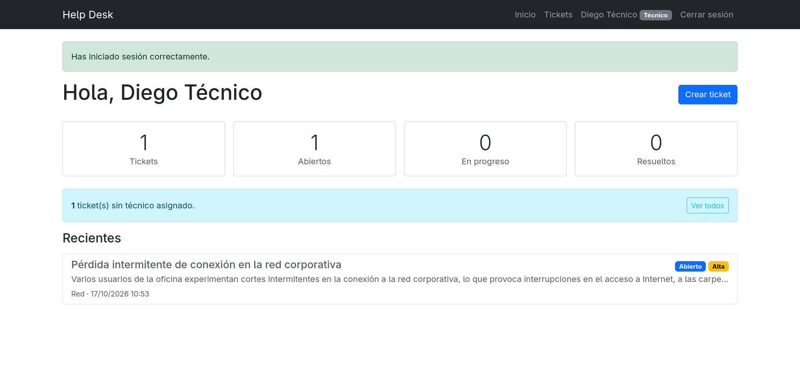
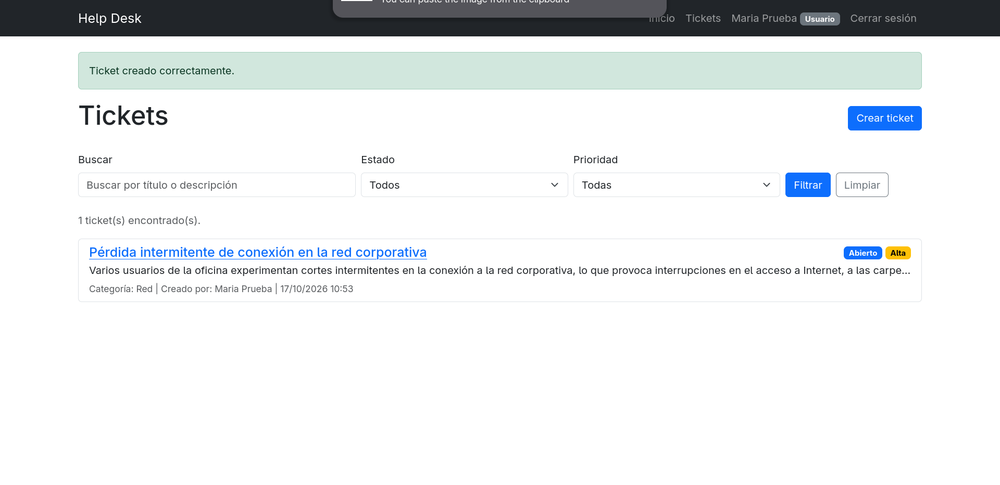
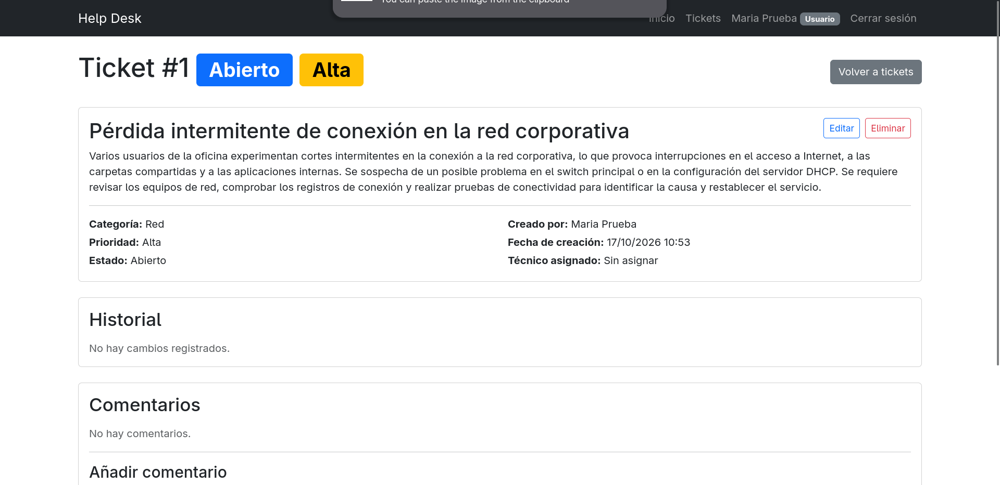
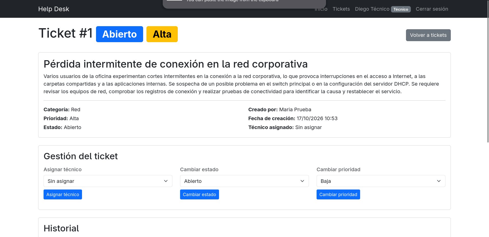
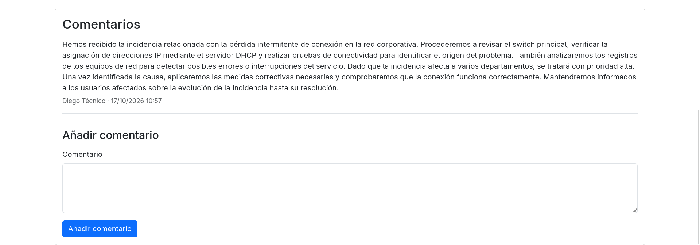
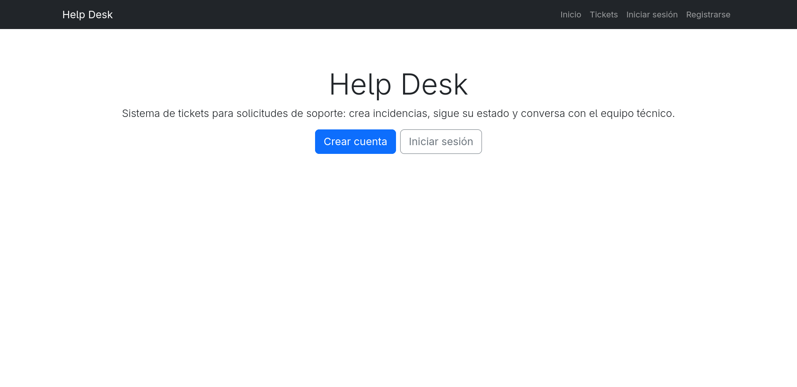

# Help Desk

[Español](README.md) | **English**

Support ticket system built with Flask.

Users create issues, the technical team manages them (state, priority,
and assignment), and every change is recorded in the ticket's history.

## Screenshots

| | |
| --- | --- |
|  |  |
| *Dashboard with statistics* | *List with search and filters* |
|  |  |
| *Ticket detail (creator's view)* | *Ticket management (technician's view)* |
|  |  |
| *Comments on the ticket* | *Public landing page* |

## Features

- **Session-based authentication** with encrypted passwords (sign up,
  sign in, and sign out).
- **Two roles**: `user` (creates and manages their own tickets) and
  `technician` (manages any ticket).
- **Tickets** with title, description, category, priority, and state.
- **Comments** on each ticket, visible to its creator and to the
  technicians.
- **Automatic history** of changes to state, priority, category, title,
  and technician assignment.
- **Filtered list**: full-text search plus state and priority filters.
- **Dashboard** with statistics and the most recent tickets.

## Permission rules

| Action | Creator | Technician | Guest |
| --- | --- | --- | --- |
| View the list / their dashboard | ✔ (their tickets) | ✔ (all) | ✘ |
| Create a ticket | ✔ | ✔ | ✘ |
| View and comment on a ticket | ✔ | ✔ | ✘ |
| Edit or delete the content | ✔ | ✘ | ✘ |
| Change state, priority, or assignee | ✘ | ✔ | ✘ |

The rule is simple and centralized in `app/auth.py`
(`can_manage_ticket` and `owns_ticket`): **the creator owns the
ticket's content and the technicians manage its flow**.

## How a ticket works

1. A user creates a ticket: it starts in the **Open** state.
2. A technician picks it up, assigns it to someone on the team, and
   moves its state and priority as needed.
3. The creator and the technicians talk in the comments.
4. The creator can fix the title, description, and category while the
   ticket exists, or delete it.

The seed states are *Open → In progress → Pending → Resolved →
Closed*. There is no state machine restricting transitions: any
technician can move a ticket to any state, and that decision is
recorded.

### Actions recorded in the history

| Recorded action | Triggered by |
| --- | --- |
| `State change` | Technician |
| `Priority change` | Technician |
| `Technician assignment` | Technician (includes unassigning) |
| `Title edit` | Ticket creator |
| `Category change` | Ticket creator |

## How to create a technician

There is no admin panel yet, so the role is assigned by hand on the
database:

```bash
sqlite3 app/database/helpdesk.db \
  "UPDATE users SET role='technician' WHERE email='you@example.com';"
```

## Requirements

- Python 3.10 or higher (tested with 3.14)
- pip

## Installation

```bash
python3 -m venv .venv
source .venv/bin/activate
pip install -r requirements.txt
```

To work with the tests:

```bash
pip install -r requirements-dev.txt
```

## Database

The migrations create the schema and the initial states/priorities;
the `seed` command also adds the categories:

```bash
flask db upgrade
flask seed
```

The SQLite file is stored in `app/database/helpdesk.db` and is ignored
by git.

## Running the application

```bash
flask run
```

or:

```bash
python run.py
```

## Tests and code quality

```bash
pytest
ruff check app tests config.py run.py
```

There are 51 tests in `tests/`:

| File | What it covers |
| --- | --- |
| `test_tickets.py` | Comment, state, and assignment permissions |
| `test_auth.py` | Registration, login, logout, and route protection |
| `test_ticket_crud.py` | Creating, editing, and deleting tickets |
| `test_ticket_management.py` | State, priority, and technician (with history) |
| `test_ticket_list.py` | Filters, search, visibility, and dashboard |

`tests/conftest.py` centralizes the fixtures: an in-memory app, seed
data, and user and ticket factories.

## Configuration

It can be overridden with environment variables (or `.env`):

| Variable | Description | Default |
| --- | --- | --- |
| `SECRET_KEY` | Session secret key | `dev-secret-key` |
| `DATABASE_URL` | SQLAlchemy connection string | Local SQLite |

## Known limitations

Things the project **does not do yet**, so nobody goes looking for
them in vain:

- There is no admin role: technicians are not created from the UI, and
  categories, states, and priorities are not managed there either.
- There is no password recovery or email verification.
- There are no notifications: nobody is told that their ticket changed.
- There are no attachments or images in the comments.
- There is no pagination: the lists load every ticket at once.
- Logout is a `GET` request, so an external link could sign someone
  out.
- The database is SQLite: fine for development, but `DATABASE_URL` must
  be changed to PostgreSQL for real concurrency.
- There is no deployment configuration (gunicorn, Docker, CI).

### Possible next steps

1. Admin panel (users, technicians, and reference tables).
2. Pagination and sorting of the list.
3. Email notifications when the state changes.
4. Password recovery.
5. POST logout with a CSRF token and session expiry.

## Structure

```
app/
  auth.py            # Current session, access decorators, and permission rules
  extensions.py      # SQLAlchemy and Flask-Migrate instances
  forms/             # WTForms forms (auth and tickets) and custom fields
  models/            # User, Ticket, Comment, History, Category, State, Priority
  routes/            # Blueprints: main (dashboard), auth, tickets
  seed.py            # Seed data (`flask seed` command)
  templates/         # Jinja2, with reusable components in templates/components
migrations/          # Alembic migrations
tests/               # pytest tests (shared fixtures in conftest.py)
config.py            # Application configuration
run.py               # Entry point
pytest.ini           # pytest configuration
ruff.toml            # Lint rules
requirements.txt     # Runtime dependencies
requirements-dev.txt # Development dependencies (pytest, ruff)
```

Every ticket route that modifies data writes an entry to `History`, and
the templates show that history ordered from newest to oldest.
